## 1.Pattern Builder 
Le pattern **Builder** est un design pattern de création qui permet de construire des objets 

**Implémentation:**

**Exécution :**

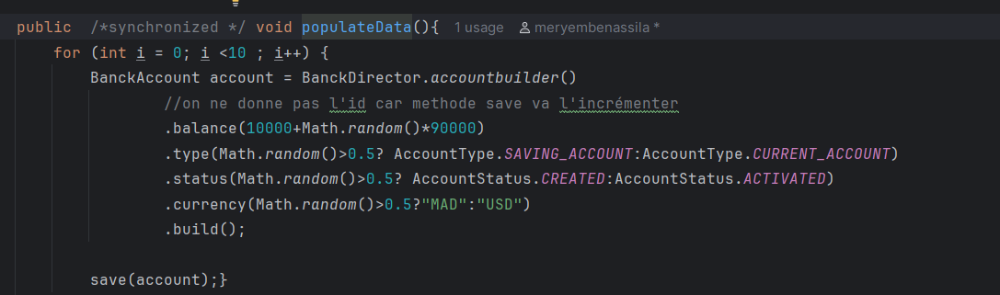

### seliarisation en Json

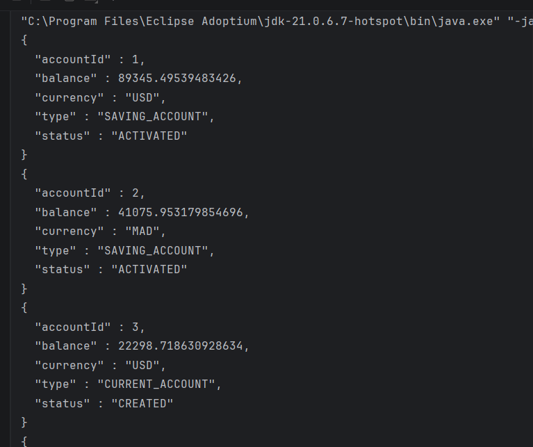

## 2. Le Pattern Singleton

Le pattern Singleton garantit qu'une classe ne possède qu'**une seule instance**  tout au long de l'exécution de l'application, et fournit un point d'accès global à cette instance

**Implémentation:**

**Exécution :** On voit que le message d'initialisation ne s'affiche qu'une seule fois, peu importe combien de fois on appelle `getInstance()`.

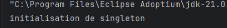

---

### Le problème de la concurrence (Multithreading)

On lance 10 threads en parallèle qui appellent la méthode `populateData()` du Singleton.

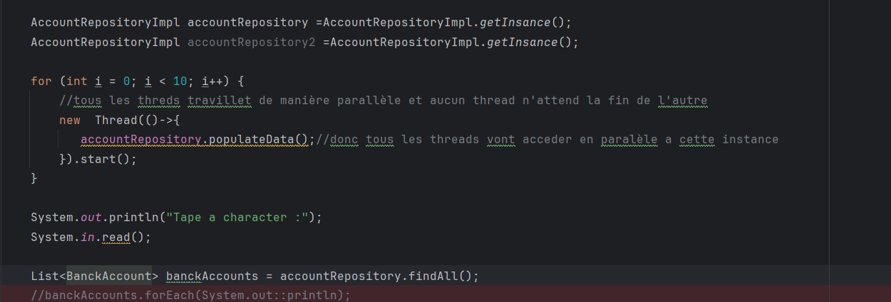

**Problème  :**
Dans la méthode `save`, l'incrémentation `accountId = ++accountcount;` n'est pas protégée. Le CPU peut être interrompu entre la lecture et l'écriture, ce qui fait que deux threads peuvent générer le même ID.

**Résultat :** Au lieu d'avoir 100 comptes créés, on se retrouve avec seulement **99 comptes** (des incrémentations ont été "perdues").

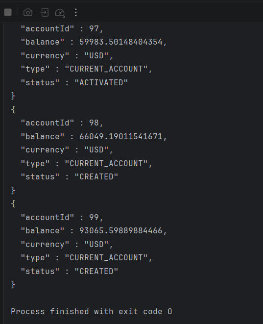

###  Solutions pour la synchronisation

**Méthode 1 : Synchroniser la zone critique (Recommandé)**

**Méthode 2 : Synchroniser toute la méthode save**

**Résultat final :** Avec l'une ou l'autre des solutions, on obtient bien nos **100 comptes**.

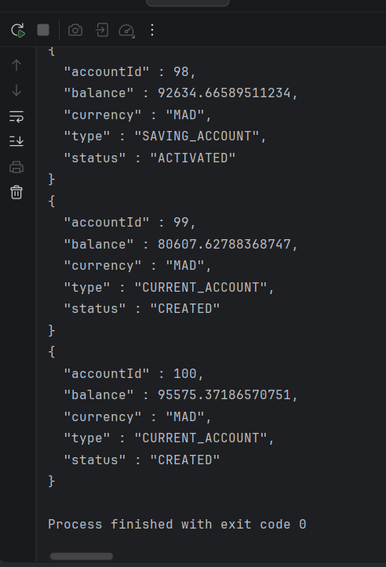

 Synchroniser la méthode `populate()` est déconseillé, car cela casse totalement le parallélisme. Chaque thread attendra la fin complète du précédent.

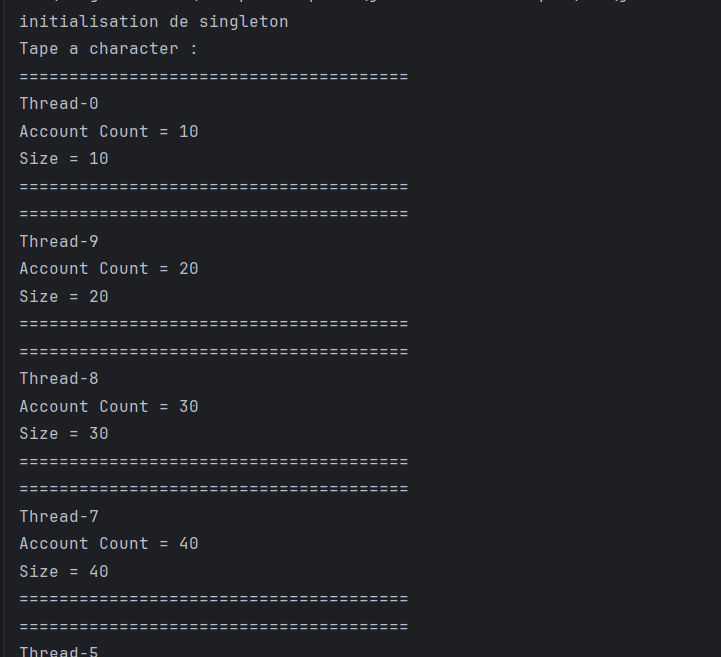

## 3.Prototype 

*   **Sans Prototype** : On instancie un nouvel objet et on copie manuellement chaque attribut via les getters/setters. C'est long et coûteux en ressources.
*   **Avec Prototype** : La classe implémente `Cloneable` et redéfinit `clone()`.  ce qui est plus rapide.

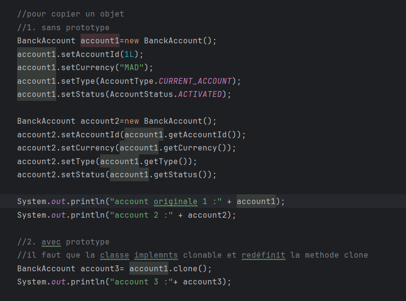

**Résultat :**

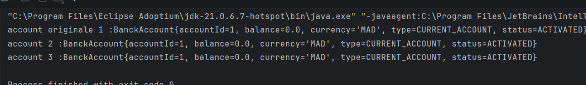

---
### Problème de  clonage

`BankAccount` contient un autre objet `Customer`, la méthode `clone()` par défaut ne clone que l'enveloppe. Elle copie la **référence mémoire** de `Customer`.

**Résultat :** modifier le `Customer` du clone modifie aussi celui de l'original !

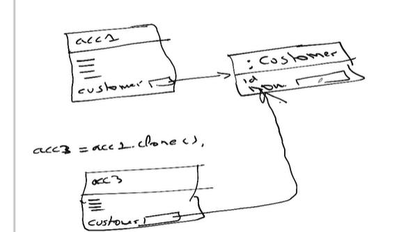

---
### La solution 
La solution et que l'attribut interne doit aussi être cloné.
1. La classe `Customer` doit implémenter `Cloneable`.
2. Dans le `clone()` de `BankAccount`, on ajoute : `this.setCustomer(this.customer.clone());`

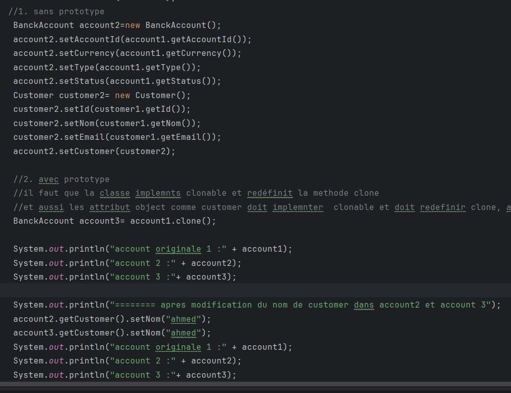

**Résultat :** Modifier le clone n'affecte plus l'original.
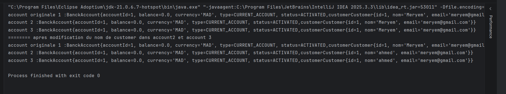