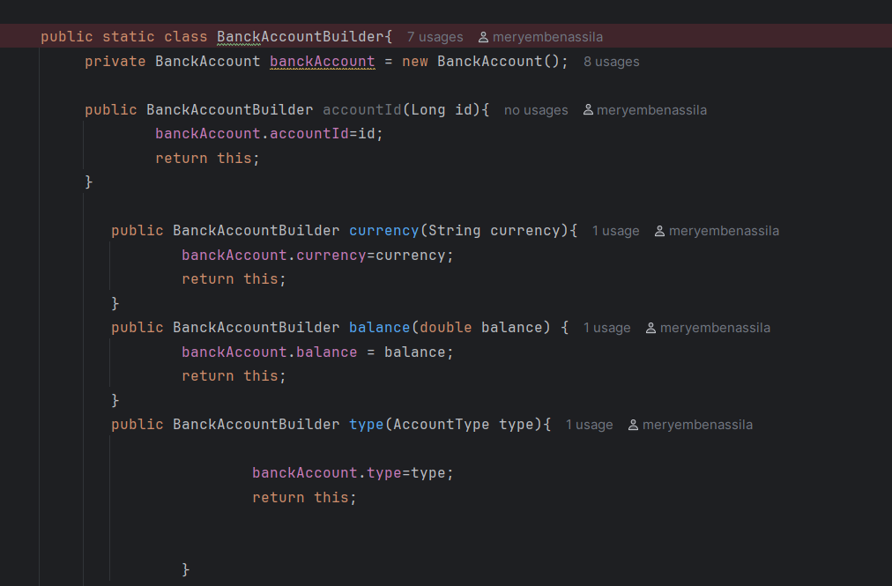
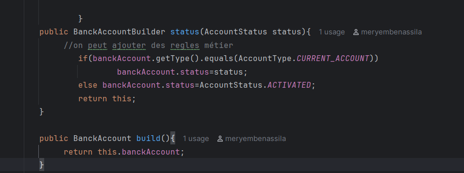
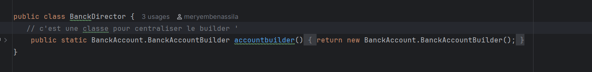
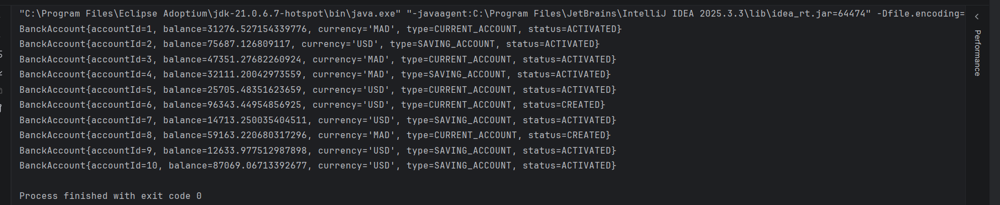
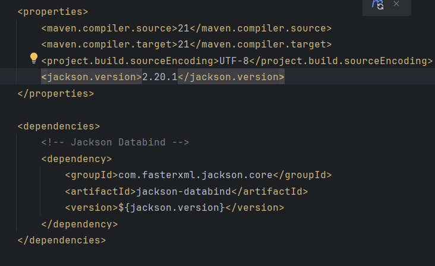
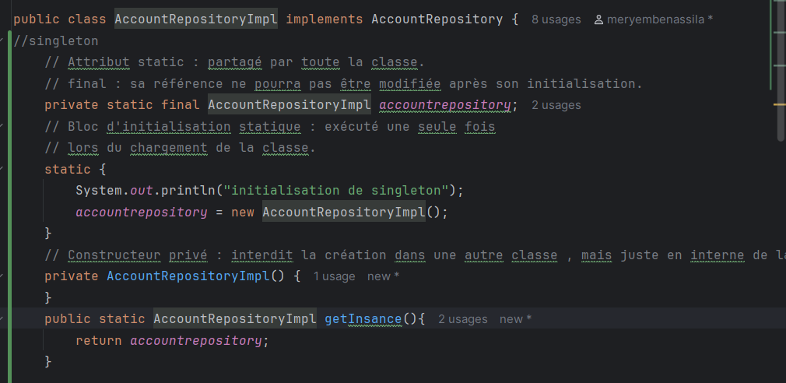
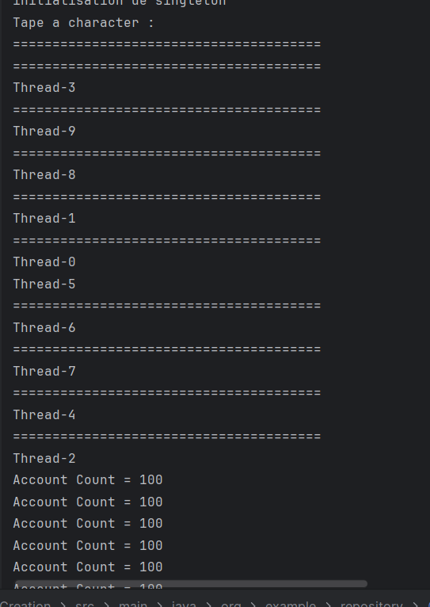
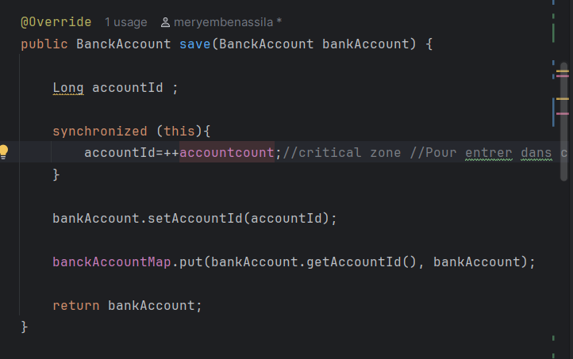
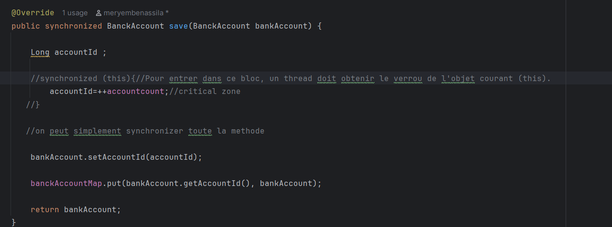

Builder 

seliarisation 

Singleton

mutithread

probleme de concurence

on a juste 99 account 

solution 
methode 1 : synchronizer critical zone 

methode 2 : synchroniser toute la methode

on a 100 account 

voici si on synchronise populate methode donc chaque thread va entrer séparement  mais ici on exploite pas le paralellisme et on synchronize le critical zone
